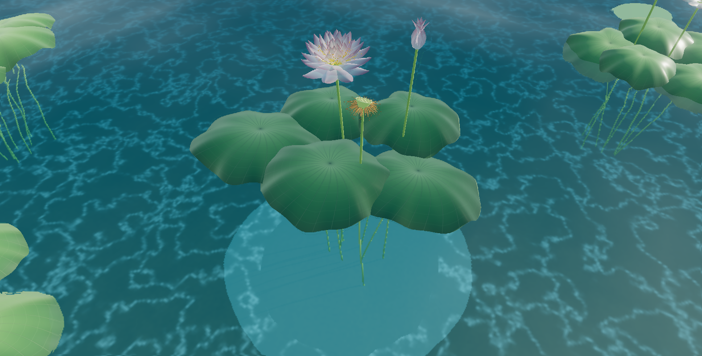
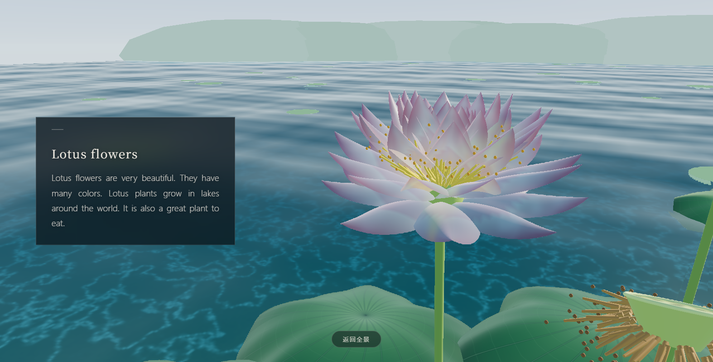
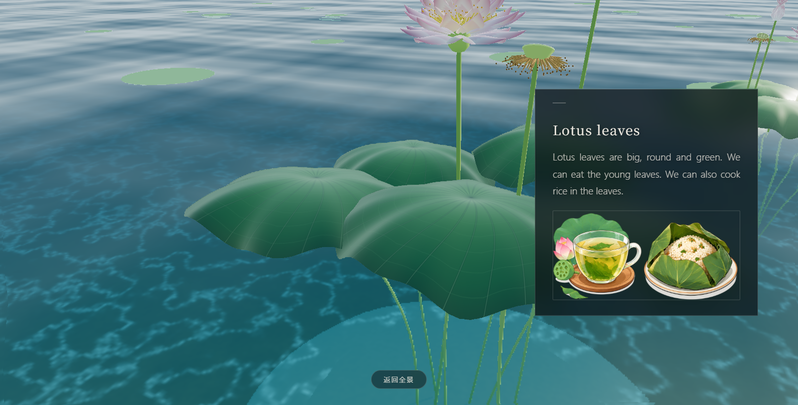
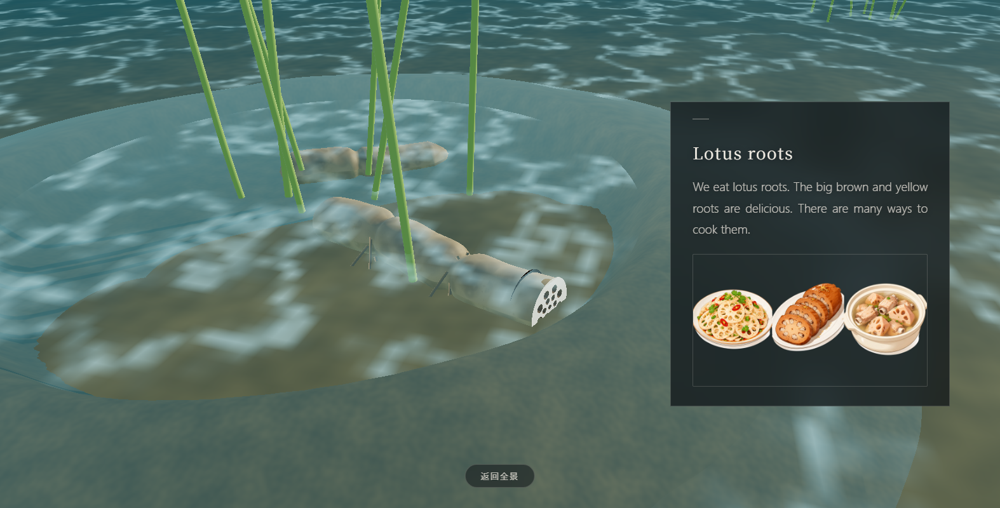

# 莲 · 一株

用 three.js 在浏览器里程序化生成的一株莲。花、花苞、莲蓬、荷叶、茎、水下的藕和泥底全部由代码现算，没有一张模型贴图；水面实时折射，镜头可以从水面一直潜到泥里，扒开泥土才看得见藕。



## 能看到什么

- **一整株都是算出来的**：花瓣的厚度与透光、荷叶的褶皱与叶脉、莲蓬上的孔洞、藕节与切面孔、根须，都是几何体与着色器拼出来的。
- **可以潜到水下**：拖动旋转、右键平移、滚轮缩放；底部「直接去水底看藕」会把你带到泥边，点一下泥土才把藕扒出来。
- **四个部位各有一张卡**：点花瓣、莲蓬、荷叶，或扒开泥土露出藕，都会弹出对应的说明与配图。

| 花 | 荷叶 | 藕 |
| --- | --- | --- |
|  |  |  |

## 运行

需要 Python 3，用来起一个本地静态服务。

- Windows：双击 `启动.bat`
- 或者命令行：`python serve.py`

浏览器会自动打开 `http://127.0.0.1:8317/index.html`。端口被占用时会自动往后找一个（8317–8328）。

不能直接双击 `index.html`：页面用 ES 模块和 importmap 加载 three.js，`file://` 下会被浏览器的跨域策略拦下。

## 操作

| 操作 | 效果 |
| --- | --- |
| 左键拖动 | 旋转 |
| 右键 / 双指拖动 | 平移 |
| 滚轮 / 双指捏合 | 缩放 |
| 点击花瓣、莲蓬、荷叶 | 摇一下，弹出说明卡 |
| 潜到水底后点击泥土 | 扒开泥，露出藕并弹出说明卡 |
| 「返回全景」/ Esc / 滚轮 | 收起卡片，必要时回到全景 |

也可以在地址后面直接带片段跳转：

```
index.html#petal          花
index.html#pod            莲蓬
index.html#leaf           荷叶
index.html#rhizome        藕
index.html#rhizome,dig    藕的视角，并把泥扒开
```

## 打包成 exe

```bat
pip install pyinstaller
python build_exe.py
```

产物是 `dist/莲.exe`：双击即启动本地服务并打开浏览器，目标机器不需要装 Python。也可以直接双击 `打包.bat`，它会先装好 PyInstaller 再调用 `build_exe.py`。

打包脚本不会把整个 `vendor/` 塞进去：它从 `src/main.js` 出发顺着 `import` 算出依赖闭包，只带页面真正用到的那些模块（约 2.2 MB）。

## 目录

```
index.html          页面骨架、样式、importmap
src/main.js         渲染器、相机、轨道控制、主循环、开场影片
src/env.js          天空与 IBL、水面、水下水体、泥底、远景
src/lotus.js        整株莲的几何与材质（含水下藕、泥、陪衬莲）
src/ui.js           交互、说明卡、取景
vendor/             three.js r186 及用到的 addons（内置，无需 npm install）
assets/             开场影片与三张做法配图
serve.py            极小的本地静态服务
启动.bat            双击运行
打包.bat            双击打包
build_exe.py        PyInstaller 打包脚本
docs/               README 用的截图
```

## 实现上几个关键点

- **水面**：先把没有水面的场景渲进一张带深度的 render target，水面着色器按屏幕空间的折射采样它，再用深度差算吸收、按菲涅尔混反射，另外叠了三层太阳光路（宽光路、波峰、碎光）。
- **花瓣**：`MeshPhysicalMaterial` 的 transmission 做透光，`onBeforeCompile` 里注入水下吸收。
- **水下**：整组材质按水深做颜色吸收，泥底再叠一层 caustics。
- **陪衬莲**：周围五株不参与拾取。它们和主株共用几何与材质，生成时按材质把几何体合并，单株的 drawcall 从一百多降到十几。
- **性能**：`renderer.transmissionResolutionScale = 0.5`，透射材质那趟额外渲染用半分辨率。

## 素材说明

`assets/` 里的开场影片和三张做法配图仅用于演示，版权归各自作者，不在 MIT 许可范围内；如需商用请自行替换。代码本身（`src/`、`index.html`、`serve.py`、`build_exe.py` 等）以 MIT 协议开源。

`vendor/` 内是 three.js r186，遵循其 MIT 许可。

旧版分层贴图实现 `index-css3d.html` 与其生成脚本 `tools/` 依赖的素材已经移除，不再纳入仓库。

## License

[MIT](LICENSE) © 2026 Liu-Abing
